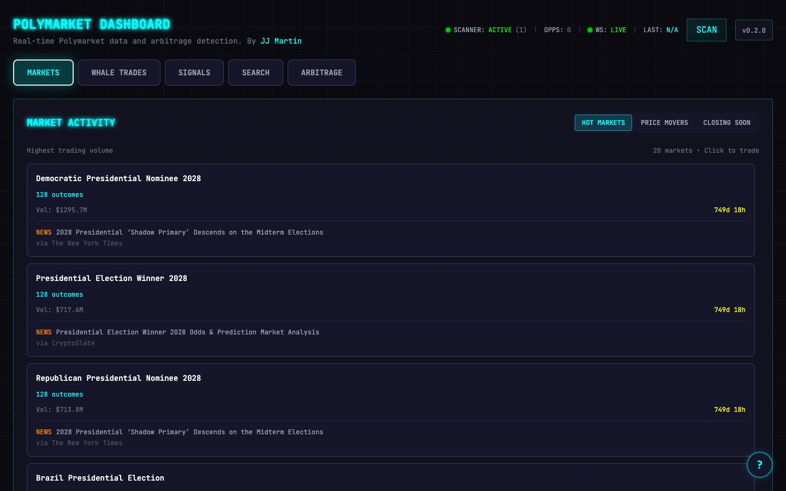

# prediction-market-arbitrage

A Polymarket scanner and dashboard. It looks for markets where YES and NO together cost less than a dollar, follows the largest recent trades, and, when run on your own machine, sends an alert when it finds an edge. It reads public data only and cannot place a trade.

[](docs/dashboard.jpg)

Live at [prediction-market-arbitrage.vercel.app](https://prediction-market-arbitrage.vercel.app), with the dashboard and the API both on Vercel. Built in January 2026; moved to Vercel in October 2026.

## What it does

- **Arbitrage scan.** Checks the most liquid two-outcome markets for YES ask + NO ask under $1.00 after an assumed fee.
- **Dashboard.** Five tabs: Markets (hot, price movers and closing soon, each with a recent news headline), Whale trades, Signals, Search and Arbitrage. Each tab has a link, such as `/#whales`.
- **Whale trades.** The largest of the latest trades of $1,000 or more, from Polymarket's Data API, with trader, side, size, price and when it happened.
- **Signals.** Heuristics read off the same data: a trade over $5,000, a market priced above 90% or below 10%, a market with over $100,000 of volume.
- **Alerts.** Printed to the console, and sent to Telegram if you configure it. Only in continuous mode (below), so not on Vercel.

## Research only

This is for research and paper trading. It is not financial advice. The code calls public endpoints only and has no wallet key setting, no signing and no order placement; a test fails if any of that is added. Every request is a GET except CLOB's `/books`, which takes its list of token ids in a POST body and returns order books, and a second test fails if any other outgoing POST appears. If you build trading on top of it, doing so with real money is entirely your own risk. Signals are rules of thumb, not predictions.

## Two ways to run

The scan is one function, `run_scan` in `backend/app/core/scan.py`. It runs in one of two modes:

| | On request (Vercel) | Continuous (your machine) |
| --- | --- | --- |
| When it scans | When a request finds the cached scan older than 30s | In a loop, 5s after each scan ends |
| Markets per scan | The 200 most liquid | The 1,000 most liquid |
| Alerts | None | Console, and Telegram if configured |
| How the dashboard updates | Polls every 30 to 60s | The same |
| Started by | Vercel, per request | `uvicorn` |

`SCANNER_MODE=auto` (the default) picks on request when the `VERCEL` variable is set and continuous otherwise.

**Why on request on Vercel.** Vercel Functions run per request: there is no process to keep a loop alive between requests, so the old background scanner cannot run there. Vercel now has WebSocket support in beta, but a connection closes when the function hits its time limit (300s on Hobby), each instance only reaches its own sockets, and with no loop there is nothing to push. So the dashboard polls, and each endpoint does its work when asked:

```
browser ── /            ──▶ Next.js (frontend/)
        ── /api/*        ──▶ FastAPI (backend/, Python 3.13)
                               │ cached 30s in the instance, and 30s (+30s stale) on Vercel's CDN
                               ▼
                     Gamma /markets, /events, /public-search
                     CLOB /books · Data API /trades · Google News RSS
```

Both halves deploy as one Vercel project with two [Services](https://vercel.com/docs/services) (`vercel.json`), so the browser calls `/api` on its own origin: no API address to configure and no CORS.

**Caching.** Two layers, neither a paid add-on. Each Python instance keeps the latest scan, market lists and trades in memory for `CACHE_TTL_SECONDS` (30), and concurrent requests share one fetch. Every successful GET carries `Cache-Control: public, max-age=0, s-maxage=30, stale-while-revalidate=30`, so Vercel's CDN answers most requests without reaching Python, and refreshes in the background. Each response says when its data was fetched (`scanned_at`, `fetched_at`), and the dashboard shows that age.

**Speed.** A scan reads its markets from Gamma in pages of 100, all at once, then their order books from `/books`, 100 tokens a request, four at a time. On 20 October 2026, from a laptop, 200 markets took 1.2s and 980 took 2.3 to 2.9s. The old scanner read two books per market one after another, and took 114s for 1,809 markets.

## How it works

**Data.** Markets and listed prices come from Polymarket's Gamma API (`/markets` by liquidity for the scan, `/events` by 24-hour volume for the lists, `/public-search` for search). Order books come from the CLOB API (`/books`). Trades come from the Data API (`/trades`). Headlines come from Google News RSS, one search per event title, cached for ten minutes and given four seconds; a market whose headline is late is shown without one. None of them needs a key.

**What counts as an opportunity.** For each two-outcome market the scanner takes the best (lowest) ask for each side:

```
cost  = yes_ask + no_ask
gross = 1.00 - cost
net   = gross - 0.02
edge  = net / cost
```

It keeps the market if `net` is positive and `edge` is at least `MIN_PROFIT_THRESHOLD` (1% by default). Example: YES 0.48 and NO 0.49 cost 0.97, which is 0.03 gross, 0.01 net, and a 1.03% edge. On 20 October 2026 none of the 200 or 980 markets cleared the bar, and the Arbitrage tab is usually empty: liquid markets are priced tightly.

**Fees and slippage.** The 0.02 is an assumption written into `yes_no_arb.py`, a flat two cents per dollar of payout. It is not read from Polymarket, so check the current fee schedule before trusting a number. Slippage is not modelled: only the best ask is used and order size and depth are ignored.

**The alert.** Plain text: the market question, the YES and NO asks and their sum, gross and net profit with the edge percentage, the time it was detected and the platform. An opportunity is alerted once while its combined cost stays the same; a new cost is a new alert. State is in memory, so a restart alerts again.

## Stack

FastAPI, httpx and aiogram (Telegram) on Python 3.13; Next.js 16 with React 19, Tailwind 3 and TanStack Query; Vercel Services, Functions and CDN cache.

## Run it locally

You need Python 3.9 or newer and Node 20.9 or newer. The tests pass on Python 3.9 and 3.13; Vercel runs 3.13.

### Backend (continuous mode, with alerts)

```
cd backend
python3 -m venv .venv
source .venv/bin/activate
pip install -r requirements.txt
cp ../.env.example .env        # optional, every value has a default
uvicorn app.main:app --port 8000
```

The scanner starts with it and prints a line per scan. The API is at `http://localhost:8000`, with its docs at `/api/docs`. To run it the way Vercel does, start it with `SCANNER_MODE=on_request`.

### Frontend

```
cd frontend
npm install
npm run dev
```

Open `http://localhost:3000`. Next.js passes `/api/*` on to the backend at `BACKEND_URL` (default `http://localhost:8000`), for example `BACKEND_URL=http://localhost:8201 npm run dev`.

`vercel dev` from the repository root also runs both services together.

### Tests

```
cd backend
pip install -r requirements-dev.txt
pytest
```

They fake Polymarket with `httpx.MockTransport`, so they need no network. They cover the detector, trade parsing, the bounded scan and its batching, the cache, the endpoints' CDN headers, and the read-only guards.

## Deploy your own on Vercel

[](https://vercel.com/new/clone?repository-url=https%3A%2F%2Fgithub.com%2Fitsmartinwho%2Fprediction-market-arbitrage&project-name=prediction-market-arbitrage)

1. Import the repository (or use the button). Leave **Root Directory** empty: `vercel.json` at the root names both services.
2. If **Framework Preset** is not **Services**, choose it. A project builds as Services only with that preset and a `services` key in `vercel.json`. With the CLI: `vercel project update <name> --framework services`.
3. Deploy. No environment variable is required. It runs on the Hobby plan.

Settings it relies on: Fluid compute (the default for new projects), Python 3.13 from `backend/.python-version`, and a 60s limit on the Python function, set in `vercel.json`.

**No alerts on Vercel.** On Hobby, Cron Jobs run at most once a day, at an hour Vercel picks within a 59-minute window. That cannot watch for an edge that lasts seconds, so the Vercel deployment sends no alerts and ignores the Telegram settings. Run the continuous mode for alerts.

## Environment variables

All optional. The frontend needs none on Vercel.

| Variable | Where | Default | What it does |
| --- | --- | --- | --- |
| `SCANNER_MODE` | backend | `auto` | `on_request`, `continuous`, or `auto` (on request on Vercel, continuous elsewhere). |
| `SCAN_MARKET_LIMIT` | backend | 200 on request, 1000 continuous | How many of the most liquid markets a scan reads. |
| `CACHE_TTL_SECONDS` | backend | `30` | How long a scan or list is reused, and the CDN's `s-maxage`. |
| `MIN_PROFIT_THRESHOLD` | backend | `0.01` | Smallest net edge to report, as a fraction of cost. |
| `SCAN_INTERVAL_SECONDS` | backend | `5` | Continuous mode: the pause after each scan. |
| `TELEGRAM_BOT_TOKEN` | backend | none | Bot token from @BotFather. Telegram is on only in continuous mode, with both this and the chat id. |
| `TELEGRAM_CHAT_ID` | backend | none | The chat the alerts go to. |
| `GAMMA_API_URL` | backend | `https://gamma-api.polymarket.com` | Markets, events and search. |
| `CLOB_API_URL` | backend | `https://clob.polymarket.com` | Order books. |
| `BACKEND_URL` | frontend, outside Vercel | `http://localhost:8000` | Where `next dev` and `next start` send `/api/*`. Read when Next.js starts or builds. |
| `NEXT_PUBLIC_API_URL` | frontend | empty (same origin) | Only to call an API on another origin. Inlined at build time. |

The Data API address (`https://data-api.polymarket.com`) is fixed in `data_client.py`.

## API

- `GET /api/status`: the mode, markets per scan, cache TTL, threshold, fee and alerts. Reads nothing from Polymarket.
- `GET /api/arbitrage/opportunities`: the latest scan, with `scanned_at`, `markets_scanned` and its diagnostics.
- `GET /api/arbitrage/diagnostics`, `/stats`, `/opportunities/{id}`
- `POST /api/arbitrage/scan`: scans now in continuous mode; on request it returns the cached scan, so a public deployment cannot be made to scan more than once per TTL.
- `GET /api/market-activity/hot`, `/movers`, `/closing-soon`, `/new`, `/search?q=`
- `GET /api/whales/activity`, `/api/whales/top-movers`
- `GET /api/news` (the signals)
- `GET /api/markets`, `/api/markets/{id}`, `/api/markets/{id}/orderbook`
- `GET /api/health`, `/api/docs`

A Polymarket failure is a 502 or 504 with a `detail` saying which request failed, never an empty list.

## Project structure

```
vercel.json              the two services and their routes
backend/
  app/
    main.py              FastAPI app, modes, Cache-Control, error handling
    config.py            settings from the environment
    clients/polymarket/  Gamma, CLOB and Data API clients, and their HTTP setup
    core/scan.py         the scan, and the service both modes use
    core/cache.py        the in-memory cache
    core/                the detector, market lists, whale trades, signals, news
    services/            the continuous loop, Telegram and console alerts
    api/routes/          the endpoints
  tests/                 offline tests and a fake Polymarket
frontend/src/            the dashboard: app/, components/, hooks/, lib/
docs/dashboard.jpg       the screenshot
```

## Limits

- **Vercel Hobby.** Functions may run up to 300s; this one stops itself at 25s and Vercel at 60s. Cron Jobs run at most daily, hence no alerts there. The plan includes 1,000,000 function invocations and 4 hours of active CPU a month, and is for non-commercial use. A cached response costs no invocation; a scan spends most of its time waiting on Polymarket, which is not active CPU.
- **Bounded scan.** On Vercel only the 200 most liquid markets are scanned, at most once per 30s per instance and region. Set `SCAN_MARKET_LIMIT` to read more.
- **Per-instance cache.** A cold Python instance starts with an empty cache and fetches again; two instances may hold scans a few seconds apart. Each response's timestamp says how old it is.
- **Gamma fallback.** When one side of a book has no asks, the scanner uses the price Gamma lists, a last or mid price you cannot necessarily buy at. In the 200 most liquid markets on 20 October 2026 that was 87 of 200. The Arbitrage tab counts it.
- **YES is the first outcome.** In a two-outcome market the first outcome is treated as YES. The sum-to-one check holds either way, but a tennis match reads `SELL ALEX MARTI PUJOLRAS` in the signals rather than `SELL YES`.
- **Headlines.** Google News may throttle requests from a data centre; a market without a headline in time is shown without one.
- **No authentication.** The API is public and read-only, allows any origin, and cannot be made to scan faster than the cache allows on Vercel.

## Licence

MIT, see [LICENSE](LICENSE).

By José (JJ) Martín Quesada, [@itsmartinwho](https://github.com/itsmartinwho).
